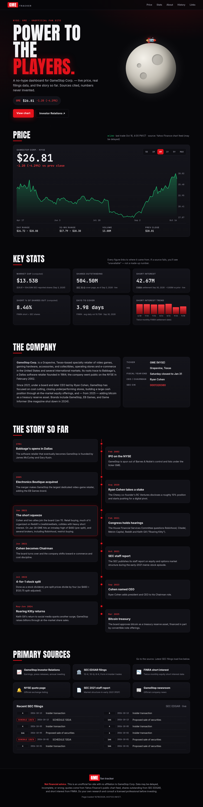

# Power to the Players

An unofficial GameStop (GME) fan site. Plain HTML, CSS, and JavaScript, no build step.

## Run locally

`python3 serve.py 8080` then open http://localhost:8080. It serves the static files plus a small same-origin proxy (`/api/chart`, `/api/shares`, `/api/short`, `/api/filings`) for live Yahoo Finance, SEC EDGAR, and FINRA data.

Static-only hosting (for example GitHub Pages) has no proxy, so the page reads `data.json`, a dated snapshot covering every chart range plus SEC shares, FINRA short interest and recent filings. Refresh it with `python3 snapshot.py`. On GitHub, `.github/workflows/snapshot.yml` refreshes it every 30 minutes during US market hours on weekdays, plus daily at 23:15 UTC. SEC requires a contact User-Agent: set a repository variable `SEC_USER_AGENT` such as `Your Name you@example.com`. If neither source works, the chart falls back to a TradingView widget.

`python3 shot.py 1280 preview.png` regenerates the screenshot.

## Publish

This repo is ready for GitHub Pages: Settings, Pages, deploy from the `main` branch, root folder.
